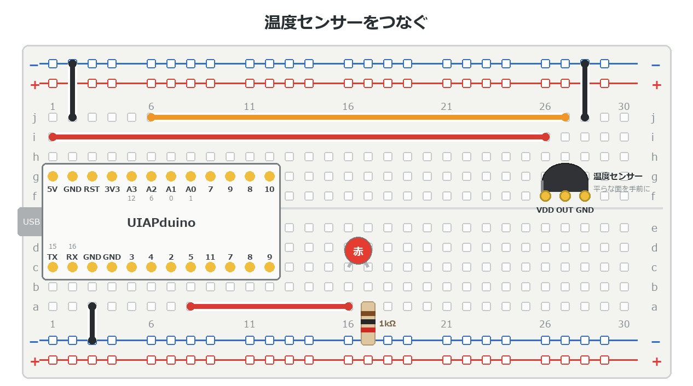

{cover}
# ② 温度をはかろう

気温を数字にする

*UIAPduino 体験ワークショップ*

---

# なにをするの？

:::

こんどは**温度**をはかってみるよ。

- 温度センサーは、温度に応じて**電圧が変わる**部品
- `analogRead` で読んで、**計算で温度に直す**
- 暑くなったら知らせる

> センサーの値をそのまま使うのではなく、**意味のある数**に直すのがこの章のポイント。

:::

> 📷 温度センサーをつないだ写真と、手で握って反応しているようす

---

# 温度センサーのしくみ
使うのは **MCP9701** というアナログ式のセンサー。足は3本だよ。

- 温度が上がると、出てくる**電圧が高くなる**
- 0℃のとき **400mV**、1℃上がるごとに **19.5mV** ずつ

> ⚠ **平らな面を手前**にして、左から **VDD・出力・GND**。
> 逆につなぐと熱くなるので、必ず確かめてから電源を入れよう。

---

# つなごう

:::

**USBケーブルを抜いてから**。**平らな面を手前**に、26〜28列にさす。

1. **VDD**（26列）→ **5V**（赤い線）
2. **出力**（27列）→ **A2**（オレンジの線）
3. **GND**（28列）→ **−レール**（黒い線）
4. LED は **5番**（16・17列）

> e1 から続けるなら、つまみ・CdS・短い線を抜き、赤い線を **26列**へ。
> ⚠ 向きをまちがえると**熱くなる**。さわって確かめてね。

:::



---

# 数を温度に直す

:::

読んだ値（0〜1023）から温度を求めるよ。

1. 読んだ値を**ミリボルト**に直す
2. **400** を引く（0℃のときの電圧）
3. **19.5 でわる**と℃になる

> 右のプログラムは **`ondo()` という部品（関数）**だけ。`setup()` と `loop()` が
> ないので、**これだけでは動かない**よ。次のページで続きを書こう。

:::

```cpp `e2_ondo` 温度をもとめる
const int SENSOR = A2;
const int LED    = 5;

float ondo() {                   // 温度（℃）をかえす
  int v = analogRead(SENSOR);
  float mv = v * 5000.0 / 1024;  // ミリボルトに直す
  return (mv - 400) / 19.5;      // ℃ に直す
}
```

---

# 数で読んでみよう

:::

温度を**十の位**と**一の位**に分けて、点滅の回数で知らせるよ。

1. 右のプログラムを `ondo()` のあとに書く
2. **長い点滅**の回数が十の位
3. **短い点滅**の回数が一の位

> **27℃** なら、長く **2回**、短く **7回**。
> 30℃ のように一の位が 0 なら、短い点滅はないよ。

:::

```cpp `e2_ondo` につづけて書く
void setup() {
  pinMode(LED, OUTPUT);
}

void tenmetsu(int n, int ms) {   // n回、ms ミリ秒ずつ光る
  for (int i = 0; i < n; i++) {
    digitalWrite(LED, HIGH); delay(ms);
    digitalWrite(LED, LOW);  delay(300);
  }
}

void loop() {
  int t = ondo();                // ℃（小数は切りすて）
  if (t < 0) t = 0;
  tenmetsu(t / 10, 700);         // 十の位：長く
  delay(800);
  tenmetsu(t % 10, 150);         // 一の位：短く
  delay(3000);
}
```

---

# ⚠ 合っているか確かめよう

:::

計算した温度が正しいか、**たしかめる方法**が大事だよ。

1. 点滅で読んだ温度を、部屋の温度計と見くらべる
2. **手で握る**と温度が上がるはず
3. ずれていたら `400` を少し調整する

> 実物と見くらべて合わせることを**校正**というよ。

:::

> 📷 部屋の温度計とならべて見くらべている写真

---

# 暑くなったら知らせよう

:::

温度がしきい値をこえたら、LEDで知らせるよ。

1. `loop()` の中を、右のように書きかえる
2. センサーを手で握ってあたためる
3. 28℃をこえるとLEDが光る

> 点滅で読むのは時間がかかる。ふだんは
> **しきい値をこえたかどうか**だけ知らせると分かりやすいよ。

:::

```cpp `e2_ondo` の loop() を書きかえる
void loop() {
  digitalWrite(LED, ondo() > 28 ? HIGH : LOW);
  delay(200);
}
```

---

# 💪 やってみよう

温度を使って、いろいろな知らせ方を試そう。

1. しきい値を **25℃・30℃** に変えて、反応を見る
2. 温度が高いほど**明るく**光るようにする
3. 暑くなったら**音**でも知らせる（b5 のブザー）
4. 温度によって**光の色を変える**（LEDを2つ、青と赤）
5. 光センサー（e1）と組み合わせて「暗くて暑いときだけ知らせる」
