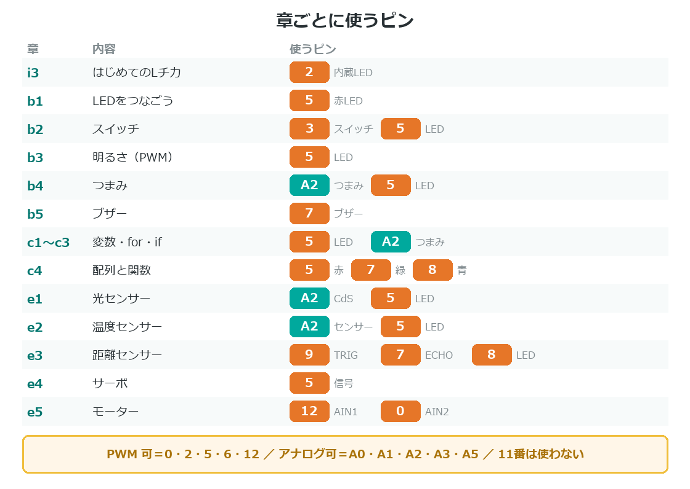

{cover}
# ⑧ メンター用 早見表

当日、手元に置いておくページ

*UIAPduino 体験ワークショップ*

---

# 章ごとに使うピン

---

# 切り分けの順番
プログラムもピンも**資料どおり**が前提。だから見るのは「**資料どおりにやっているか**」。
「動かない」と言われたら、この順に聞く。

1. **配線は図どおり？**（列・向き・抵抗・GND。USB を抜いて見る）
2. **書きこめた？**（RESET を押しながら USB をさしたか。`Image written.` が出たか）
3. **書きこんだあと RESET を押した？**
4. **プログラムは資料どおり？**（写しまちがい・自分で書きかえたところ）

> 2と3はこのボード特有。**最初の30分は、ほぼこれだけ**と思っていい。
> 付録②「こまったときは」に、各段階の対処がある。

---

# 時間の目安
**実績 … 導入編 ＋ 基本編 b1〜b5 で 約2時間**（スムーズに進んだとき）

**半日コース … 3時間**

- 導入編 ＋ 基本編 b1〜b5（約2時間）→ のこりで制御編 c1〜c4 を**ざっと**

**1日コース … 6時間**

- 午前は半日コースと同じ ／ 午後は発展編 e1〜e6

**複数日コース** … 1日コースのあと、作品編を 3時間 × 2回（p1〜p4 ／ p5〜p8）

> 制御編は**しっかり勉強しなくていい**。ざっと流して、発展編で**使いながら覚える**ほうが身につく。
> かかる時間は、年齢・人数・メンターの数で大きく変わるよ。

> ⚠ 発展編・作品編はまだ実績がない。**やってみて直す**前提の見積もり。

---

# 事前に用意すること
当日あわてないための準備。

- PCに **Arduino IDE ＋ UIAPduino のボードパッケージ**を入れておく
- ボードを1枚**書きこみテスト**しておく（USBケーブルの相性確認）
- 抵抗は **1kΩ** だけ（LED 用）。配る前に**色を確かめておく**
- 予備のジャンパーワイヤーを多めに（**断線がいちばん多い**）
- USB 給電の基板（秋月 117123）は**はんだ付けしておく**。充電器は USB-A の口のもの

> ⚠ USBケーブルは「充電専用」だと書きこめない。**ぜんぶテストしておく**。

---

# ⚠ 当日までに確かめること
部品の仕様は資料で確認ずみ。のこりは**実機での動き**だけ。

- **e4** … `TRIG` を **9番**にしてある（実機テストは 5番で実施した）
- **e2** … 温度センサーの校正（部屋の温度計と見くらべる）
- **e1** … つまみを**反時計回り**に回しきると 10kΩ になるか
- **b5** … `tone()` と `analogWrite` が同時に使えるか（タイマーを分けた場合）
- **e2** … 温度センサーを逆にさしたときの挙動（資料に記載がない）
- **m1** … LCD のアドレス（`0x3F`／`0x27`）を**全台**調べる（`verify/v22_i2cscan`）

> ⚠ ここは**通しで一度ずつ**動かしておくと、当日あわてないよ。

>| 公式図どおりに使えないピンや、コアの不具合は
>| **付録⑪「実機とコアの落とし穴」**にまとめてある。

---

# 声のかけ方
手が止まっている子には、答えではなく**次の一手**を渡す。

- 「どこまで動いた？」… 切り分けの習慣がつく
- 「LEDで見てみようか」… このボードのデバッグ方法
- 「1つ前にもどしてみよう」… 動いていた地点に帰る

> できた子には 💪 を案内する。各章の最後にあるよ。
